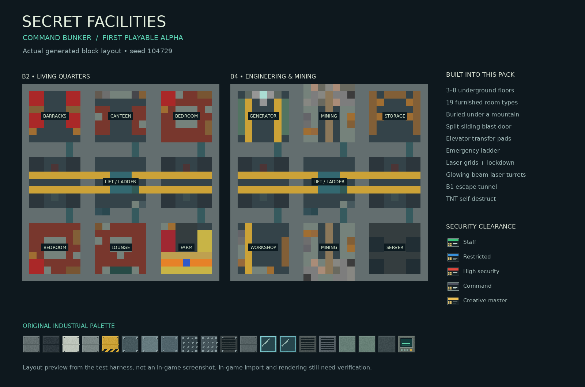
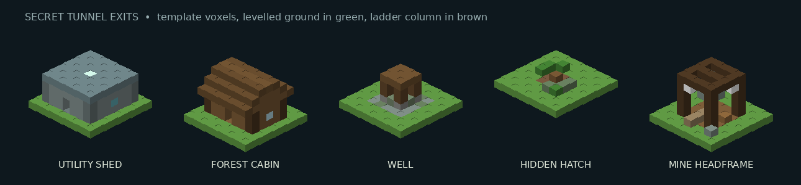
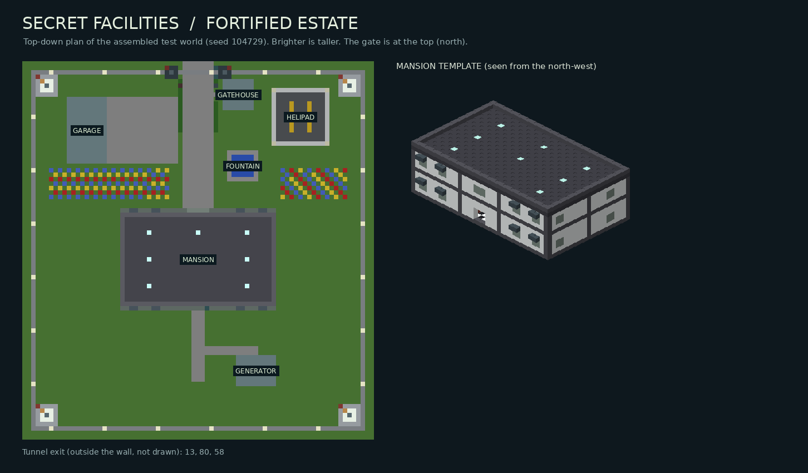

# Secret Facilities

A Minecraft **Bedrock Edition** add-on built from `Secret_Facilities_Plan.md`.

**Release: 0.1.0 alpha — command bunker and fortified estate.** This is an importable implementation of the first two facilities, not the complete eleven-facility Version 1.0. Automated checks pass; Minecraft import, rendering, sound, controller/mobile interaction, and multiplayer behavior have **not** been tested in a running game.

[Download the add-on](dist/Secret_Facilities_0.1.0.mcaddon) · [Installation and controls](docs/PLAY_GUIDE.md) · [Test checklist](docs/TESTING.md) · [Implementation status](docs/STATUS.md)







The previews are rendered from the actual assembled block data and template voxels in the test harness. They are not Minecraft screenshots.

## Install and start

1. Open `dist/Secret_Facilities_0.1.0.mcaddon` with Minecraft Bedrock **1.21.90 or later**. Import both packs.
2. Create a Creative test world with cheats enabled. Activate **Secret Facilities BP** and **Secret Facilities RP**. No experimental toggles are intended to be required.
3. Find **Facility Deployment Device** in the Creative inventory, or run:

   ```mcfunction
   /scriptevent secretfacilities:kit
   ```

4. Stand on open ground. Hills, dips and shallow water are levelled automatically, and a mountain is raised over the finished bunker. Use the device, choose 3–8 floors and an escape exit (automatic by default), and confirm the displayed site. **Deployment replaces terrain/buildings in its footprint.** Use a test world or a backup.
5. Stay near the build until “Bunker ready” appears. The entrance faces north (−Z). Use its reader with a keycard in your inventory.

For the secure mansion, choose **Deploy fortified estate** instead and stand where you want its forecourt. The gate goes about 15 blocks north of you, and the compound reaches about 40 blocks to each side and 65 blocks to the south.

If the kit command is unavailable, use `/give @s secretfacilities:facility_deployment_device`, then choose **Get development kit** in its menu.

## Included

- A 27-block-square modular command bunker with 3–8 underground floors, and 56 binary `.mcstructure` templates in all.
- A **fortified estate**: a secure two-storey mansion in a walled, fenced and floodlit compound, with a gatehouse, blast-door gate, four watchtowers, a garage, a helipad, gardens and a generator house. Beneath it is a 3–5 floor bunker, reached by the lift in its grand hall. Window and garage shutters close in a lockdown, and nine laser turrets guard the gate, walls, roof, command deck and tunnel.
- Floors with a purpose — living quarters, command, engineering & mining, hydroponics, research — furnished from 19 room types with working vanilla blocks: bunk rooms and bedrooms with real beds, lounges, mess halls, hydroponic farms with growing crops, live mining faces full of ore, workshops, labs, infirmaries, data centres, strongrooms and supply depots.
- The whole site buried under a seeded mountain, with an open, overhung portal and approach cut.
- Automatic cut-and-fill site levelling and solid rock encasement, so no floor surfaces through a hillside.
- A five-block-wide entrance blast door that splits down the middle and slides apart sideways, room security doors, readers, alarm shutters, and emergency lights.
- Four clearance levels and a Creative-only master card.
- Multi-floor elevator transfer pads, a continuous emergency ladder, and a secret B1 escape tunnel. It runs under the mountain to a remote, terrain-matched exit: a utility shed, forest cabin, old well, hidden hatch or abandoned mine headframe. A keycard door, a laser grid and a junction turret guard it.
- Horizontal and vertical laser grids, alert/lockdown controls, shared facility state, and saved configurations.
- Two exterior laser turrets and one command-level turret when defences are enabled; range, line-of-sight, reload, zone controls, and a conservative hostile-only target filter.
- A two-confirmation, 90-second self-destruct sequence with evacuation and an abort window, then TNT charges built into the rock around every floor blow and the bunker is demolished floor by floor.
- Turret shots drawn as a solid, glowing laser beam.
- Laser and missile turret spawn eggs, so you can place working defences anywhere. The missile turret has a 10-block minimum range, fires scripted missiles with a smoke trail, and its blasts hurt only hostile mobs and break no blocks.
- 47 custom construction/control blocks, seven custom items, two turret spawn eggs, original 32×32 pixel textures, laser turret, missile turret and missile models, aiming animation, five particles, twelve synthesized sounds, and pack icons.

## Build from source

Requires Node.js 20+ and Python 3.10+ with Pillow. Minecraft API packages are compile-time definitions; they are supplied by the game at runtime.

```sh
npm install
python3 tools/build_assets.py
npm test
python3 tools/validate.py
python3 tools/preview.py
python3 tools/package.py
```

Alternatively, `python3 tools/bootstrap.py` downloads the pinned TypeScript compiler and official Minecraft API packages without running package lifecycle scripts. The compiler can then be invoked with `node node_modules/typescript/bin/tsc -p tsconfig.json`.

`npm test` compiles TypeScript, tests 600 procedural plans, assembles real templates in a mock world, verifies paths and security behavior, and writes the data for the preview. The validator independently decodes the little-endian NBT, checks JSON and local references, and inspects textures/audio. These checks do not replace Minecraft's content log or runtime testing.

## Project structure

| Folder | Purpose |
|---|---|
| `src/` | TypeScript: shared rules, planner, generation, persistence, security, defence, and menus |
| `behavior_pack/` | Importable pack, compiled scripts, custom definitions, and binary structure templates |
| `resource_pack/` | Original pixel textures, geometry, animation, particles, sound, and names |
| `tools/` | Reproducible asset generation, validation, preview, and packaging |
| `tests/` | Pure rules and simulated-world integration tests |
| `docs/` | Controls, architecture, assets, status, and manual acceptance checks |
| `dist/` | Combined `.mcaddon`, separate `.mcpack` files, and SHA-256 checksums |

The later facility types (mountain, Arctic, desert, island, silo, laboratory, listening station, metro, volcano), missile turrets inside generated facilities, horizontal cave and drainage-pipe exits, natural generation, jigsaw pools, and advanced animation/art stages remain on the [roadmap](docs/STATUS.md). Guards, loot, quests, stories, and handheld weapons have not been added.
