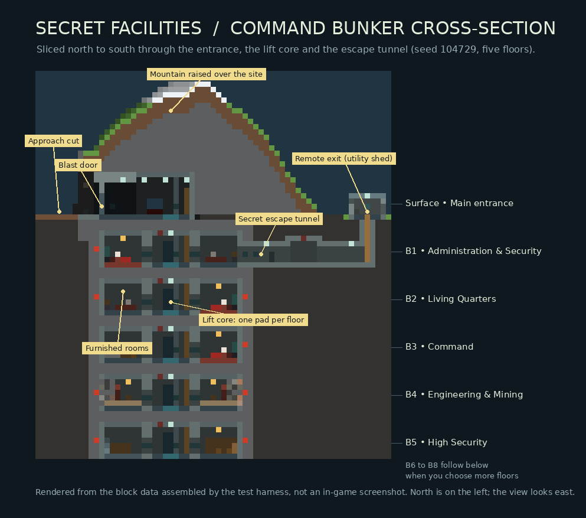
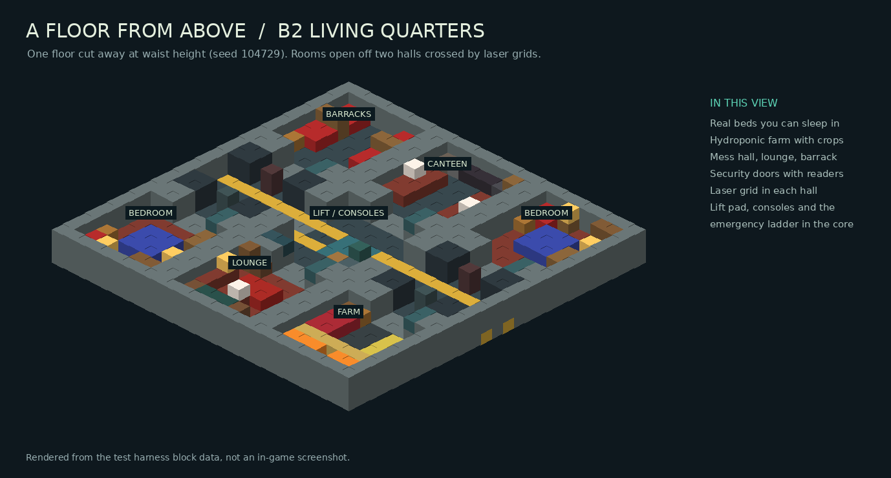
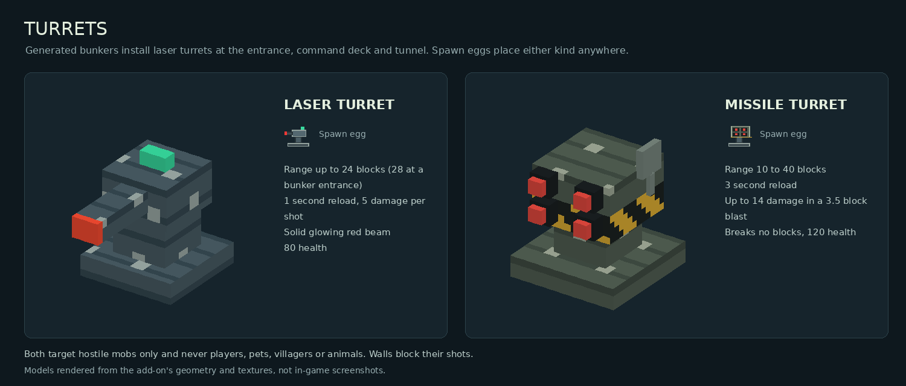
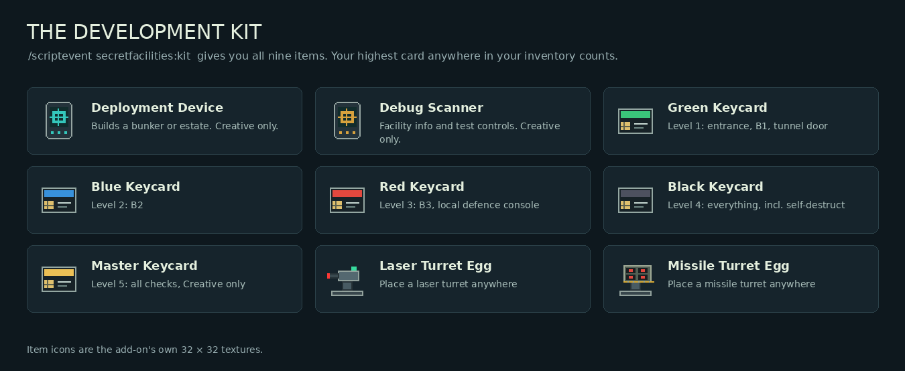
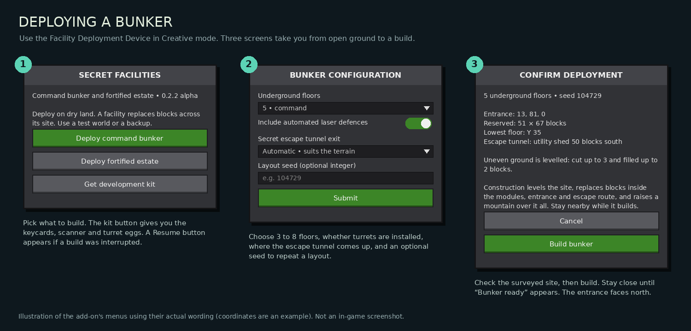
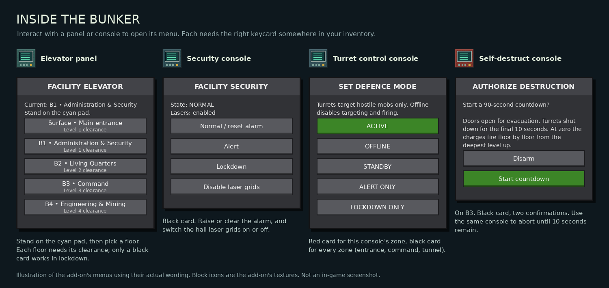
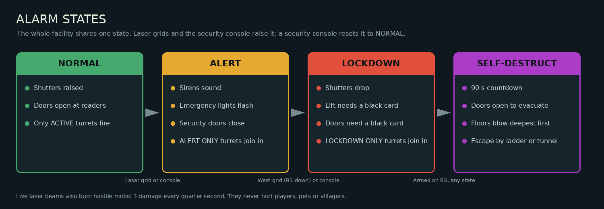

# Secret Facilities

A Minecraft **Bedrock Edition** add-on that builds secret underground bunkers for you. Stand on open ground, use the **Facility Deployment Device**, and a multi-floor command bunker is dug out beneath you and buried under a mountain. It comes with keycard doors, an elevator, laser tripwires, alarm lockdowns, defence turrets, a hidden escape tunnel and a self-destruct sequence. You can also build a **fortified estate**: a walled mansion compound with its own bunker underneath.

**Release: 0.2.2 alpha.** This release has the first two facilities from [`Secret_Facilities_Plan.md`](Secret_Facilities_Plan.md): the command bunker and the fortified estate. Automated checks pass, but import, rendering, sound, controller and touch input, and multiplayer have **not** yet been tested in a running game.

**[Download the add-on](dist/Secret_Facilities_0.2.2.mcaddon)** · [Full play guide](docs/PLAY_GUIDE.md) · [Test checklist](docs/TESTING.md) · [Implementation status](docs/STATUS.md) · [Changelog](CHANGELOG.md)



> The images in this README are drawn from the add-on's own block data, textures, models and menu text. They are not in-game screenshots.

## Contents

- [What it does](#what-it-does)
- [Install](#install)
- [Quick start](#quick-start)
- [How to use your bunker](#how-to-use-your-bunker)
- [The fortified estate](#the-fortified-estate)
- [Troubleshooting](#troubleshooting)
- [Build from source](#build-from-source)

## What it does

**A command bunker, built in place.** Each bunker is a 27 × 27 block plate of rooms, 3 to 8 floors deep, generated from a seed so every one is different. It is built from 57 structure templates. The site is levelled for you: hills are cut away and dips, caves and shallow water are filled. The bunker is then encased in stone and a mountain is raised over the top, with an open cave-mouth entrance and an approach cut on the north face.

**Floors with a purpose.** Each floor has a theme (Administration & Security, Living Quarters, Command, Engineering & Mining, High Security, Hydroponics & Supply, Research, Deep Excavation). Its six rooms are furnished from 19 room types using working vanilla blocks. You get beds you can sleep in, hydroponic farms with growing crops, mining faces full of ore, workshops, labs, infirmaries, data centres, strongrooms and supply depots.



**Security that works.** The highlights:

- A five-block-wide entrance **blast door** that splits down the middle and slides apart.
- **Keycard readers** on every door, with four clearance levels plus a Creative-only master card.
- **Laser tripwire grids** across the halls. They raise the alarm on intruders and burn hostile mobs caught in the beams.
- **Alarm states** (Normal, Alert, Lockdown) with sirens, flashing lights, closing doors and dropping shutters.
- **Laser turrets** at the entrance, the command deck and the escape tunnel. You can set each defence zone's mode yourself.

**Getting around.** Every floor has an elevator pad and panel in the central lobby, and an emergency ladder runs from the deepest floor to the surface.

**An armoury.** Off the surface lobby are twelve armour stands in enchanted, trimmed suits of gold, diamond and netherite armour, each with a matching sword. A new set is dealt for every bunker.

**A secret escape tunnel.** A hidden passage leaves B1, passes a keycard door, a laser grid and a turret, and climbs up to a remote exit well away from the mountain. The exit is matched to the terrain: a utility shed, forest cabin, old well, hidden hatch or abandoned mine headframe.


**Self-destruct.** A two-step, 90-second countdown on the Command floor. When it reaches zero, TNT charges set into the rock blow the bunker apart floor by floor, starting with the deepest.

**Turrets you can place anywhere.** Laser and missile turret spawn eggs work in any world, with or without a bunker. Both target hostile mobs only.



The pack also includes 47 custom construction and control blocks, seven custom items, original 32 × 32 pixel textures, turret and missile models, five particle effects and twelve synthesized sounds.

## Install

**You need:** Minecraft Bedrock Edition **1.21.90 or later** on Windows, iPhone, iPad, Android, Xbox or any other Bedrock platform. No experimental toggles should be required.

1. **Download** [`Secret_Facilities_0.2.2.mcaddon`](dist/Secret_Facilities_0.2.2.mcaddon) from the `dist/` folder.
2. **Import it into Minecraft:**
   - **Windows:** double-click the `.mcaddon` file. Minecraft opens and imports both packs.
   - **iPhone or iPad:** save the file to the Files app, tap it (or use **Share** and choose **Minecraft**).
   - **Android:** open the file from your downloads and choose Minecraft.

   You should see "Successfully imported" messages for **Secret Facilities BP** (behaviour pack) and **Secret Facilities RP** (resource pack). If your platform cannot open `.mcaddon` files, import [`Secret_Facilities_Behavior.mcpack`](dist/Secret_Facilities_Behavior.mcpack) and [`Secret_Facilities_Resources.mcpack`](dist/Secret_Facilities_Resources.mcpack) separately.
3. **Create a new world** (or edit a copy of an existing one):
   - Set the game mode to **Creative** and turn **cheats on**.
   - Under **Behavior Packs**, activate **Secret Facilities BP**. Minecraft will offer to activate the matching resource pack too; accept. Otherwise, activate **Secret Facilities RP** under **Resource Packs**.
4. **Play the world.** Deployment replaces terrain and buildings across its footprint, so use a test world or keep a backup.

Checksums for the downloads are in [`dist/SHA256SUMS.txt`](dist/SHA256SUMS.txt).

## Quick start

### 1. Get the development kit

In chat, run:

```mcfunction
/scriptevent secretfacilities:kit
```

This gives you the deployment device, the debug scanner, all five keycards and both turret spawn eggs. Items you already have are not duplicated. You can also find the **Facility Deployment Device** in the Creative inventory, or run `/give @s secretfacilities:facility_deployment_device` and choose **Get development kit** from its menu.



### 2. Deploy a bunker

Stand on open, dry ground. The entrance is placed about ten blocks south of you, facing north (−Z), and the bunker extends south underneath. Use (right-click or tap and hold) the **Facility Deployment Device** and follow the three screens:



1. Choose **Deploy command bunker**.
2. Pick the number of floors (3 to 8, default 5), whether to install laser defences, where the escape tunnel should come up (automatic is usually best), and an optional seed if you want to rebuild a particular layout.
3. Check the surveyed site. The confirmation shows the entrance coordinates, the reserved footprint, the depth of the lowest floor, where the escape tunnel exits, and how much ground will be cut or filled. Choose **Build bunker**.

**Stay near the site while it builds.** Construction places one piece every two ticks and keeps the area loaded with temporary ticking areas. When it finishes you will see **Bunker ready**. If the build is interrupted (for example, you walk away or close the game), return to the site, use the device again and choose **Resume interrupted construction**.

### 3. Go inside

Walk up the approach cut to the blast door on the north face of the mountain. Keep a keycard anywhere in your inventory (you don't need to hold it) and use the **keycard reader** beside the door. The door splits and slides open over about two seconds.

## How to use your bunker

### Keycards and doors

Your **highest-clearance card anywhere in your inventory** is the one that counts. To test a lower clearance, remove the higher cards from your inventory first.

| Card | Level | Opens |
|---|---:|---|
| Green | 1 | The entrance, B1 and the escape tunnel door |
| Blue | 2 | B2 and everything green opens |
| Red | 3 | B3 and its local defence console |
| Black | 4 | B4 and deeper, the security console, every defence zone and self-destruct |
| Master | 5 | Everything, but only in Creative mode |

Interact with a reader on either side of a door to open or close it. Doors inside the facility start open and close when an alarm is raised. A door waits to close if something is standing in its way.

### Consoles and panels

Each floor's central lobby has an **elevator panel** next to a cyan elevator pad, plus a **security console** and a **turret control console** in its south wall. The **self-destruct console** is on B3 (Command). Interact with any of them to open its menu:



- **Elevator:** stand on the cyan pad, use the panel and pick a floor. The ride is announced deck by deck and then you are moved to the destination pad. Step off the pad to cancel. The **emergency ladder** on the east side of the lobby connects every floor too.
- **Security console** (black card): set the facility to Normal, Alert or Lockdown, and switch the hall laser grids on or off.
- **Turret control console:** a red card sets this console's zone; a black card sets every zone. The modes are **Active** (always fires at hostile mobs), **Offline**, **Standby**, **Alert only** and **Lockdown only**.

### Alarms and laser grids

The whole facility shares one alarm state:



Each hall has a laser grid of three red beams at ankle, waist and chest height. Walking through it without a black or master card raises the alarm. The west grid triggers **Lockdown** from B3 down and **Alert** above that; the east grid triggers **Alert**. Live beams burn hostile mobs (3 damage every quarter second) but never hurt players, villagers, animals or pets. If you want to wander freely, disable the grids at a security console first. Then choose **Normal / reset alarm** to clear the alarm.

### Defences

With defences enabled, two laser turrets guard the entrance (Active, 28-block range), one covers the command corridor (Alert only, 16 blocks) and one guards the escape tunnel junction (Alert only, 16 blocks). Each shot is a glowing red beam doing 5 damage. Turrets only target hostile mobs, cannot shoot through walls and never break blocks. A destroyed turret is not rebuilt.

To place your own, use a **Laser Turret** or **Missile Turret** spawn egg on any block. Placed turrets are always active and are not connected to a facility's consoles. The missile turret has a 10 to 40 block range and won't fire at anything closer, so pair it with a laser turret.

### The armoury

A doorway in the east wall of the surface lobby leads to the armoury: twelve armour stands, each in a full enchanted suit of gold, diamond or netherite armour with a matching trim and sword. Take whatever you like.

### The secret escape tunnel

On B1, go into the room directly south of the central lobby and through its rear wall. The tunnel passes a keycard door (green card or better), a laser grid and a junction chamber with a turret. It then climbs a ladder to the remote exit, 37 to 55 blocks from the core. The confirmation screen, the debug scanner and the self-destruct screen all tell you which exit you have and where it is. The tunnel works both ways: anyone coming in from the exit trips its laser grid, and the alert shuts the tunnel door.

### Self-destruct

On B3, use the **self-destruct console** with a black card. Arm it, then authorize it: two separate confirmations. Then:

1. A 90-second countdown starts and every door and shutter opens so everyone can evacuate.
2. Turrets stop firing for the final 10 seconds. You can abort from the same console until then.
3. At zero the floors are demolished one per second, deepest first. Rooms are gutted, ceilings collapse and fires break out. Finally the lobby caves in and the entrance is sealed with rubble.

The explosions are real and will hurt anyone still inside, so get out by the emergency ladder or the escape tunnel, which is left standing. A destroyed facility stays destroyed.

### Debug scanner

The Creative-only **Facility Debug Scanner** shows a nearby facility's ID, seed, bounds, floors and system counts. It can also reset security, test alert and lockdown, open or close every door, and switch every defence on or off.

## The fortified estate

Choose **Deploy fortified estate** in the deployment device instead. Stand where you want the forecourt: the gate is built about 15 blocks north of you, and the compound reaches about 40 blocks to each side and 65 blocks south.


You get a walled, fenced and floodlit compound with a watchtower in each corner, a blast-door gate with a reader in its east pillar, a gatehouse, a three-bay garage, a helipad, gardens and a generator house. The two-storey mansion has bedrooms, a dining room, kitchen, library and a study that doubles as the defence control room. Its window shutters drop during a lockdown. The lift in the grand hall goes down to a 3 to 5 floor bunker beneath the mansion, with the same rooms, consoles, escape tunnel and self-destruct as the command bunker. With defences enabled, nine laser turrets guard the gate, the walls, the roof, the command deck and the tunnel.

## Troubleshooting

| Problem | What to check |
|---|---|
| Purple or missing textures, invisible blocks | Activate **both** packs on the world, then leave and reopen it |
| The device does nothing | You must be in Creative mode with both packs active on 1.21.90 or later. Check the content log for script errors |
| "Part of the site has not loaded" | A world allows 10 ticking areas. Remove unused ones (`/tickingarea list`, `/tickingarea remove <name>`) or raise the simulation distance, then deploy again |
| Build paused | Go back to the site and choose **Resume interrupted construction** |
| A door or reader seems to ignore your card | Your highest card anywhere in your inventory is used. Remove black and master cards to test lower ones |
| Alarms keep going off | Disable the laser grids at a security console, or clear whatever is blocking a beam, then reset to Normal |
| The elevator won't go | Stand on the cyan pad and make sure the destination pad is clear. Use the ladder if a floor isn't loaded |
| A turret doesn't fire | Check the difficulty isn't Peaceful, the target is hostile and in range and sight, and the zone's mode |

See the [play guide](docs/PLAY_GUIDE.md) for more detail. When reporting a problem, please include your Minecraft version, any content log error, the facility seed and what you were doing.

## Build from source

Requires Node.js 20+ and Python 3.10+ with Pillow. The Minecraft API packages are compile-time type definitions; the game supplies them at runtime.

```sh
npm install
python3 tools/build_assets.py
npm test
python3 tools/validate.py
python3 tools/preview.py
python3 tools/readme_art.py
python3 tools/package.py
```

Alternatively, `python3 tools/bootstrap.py` downloads the pinned TypeScript compiler and official Minecraft API packages without running package lifecycle scripts. The compiler can then be run with `node node_modules/typescript/bin/tsc -p tsconfig.json`.

`npm test` compiles the TypeScript, tests 600 procedural plans, assembles real templates in a mock world, verifies paths and security behaviour, and writes the data used by the previews. The validator independently decodes the little-endian NBT, checks JSON and local references, and inspects textures and audio. `tools/preview.py` and `tools/readme_art.py` render the images in `docs/` from that data. None of these checks replace Minecraft's content log or testing in the game.

### Project structure

| Folder | Purpose |
|---|---|
| `src/` | TypeScript: shared rules, planner, generation, persistence, security, defence and menus |
| `behavior_pack/` | Importable pack, compiled scripts, custom definitions and binary structure templates |
| `resource_pack/` | Original pixel textures, geometry, animation, particles, sound and names |
| `tools/` | Reproducible asset generation, validation, preview images and packaging |
| `tests/` | Pure rules and simulated-world integration tests |
| `docs/` | Play guide, architecture, assets, status, manual acceptance checks and README images |
| `dist/` | Combined `.mcaddon`, separate `.mcpack` files and SHA-256 checksums |

## Roadmap

The later facility types (mountain, Arctic, desert, island, missile silo, laboratory, listening station, metro and volcano), missile turrets inside generated facilities, cave and drainage-pipe exits, natural world generation, jigsaw pools and further animation and art stages are on the [roadmap](docs/STATUS.md). Guards, loot, quests, stories and handheld weapons have not been added.
